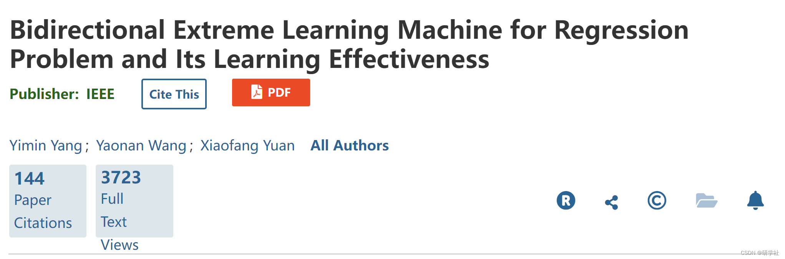
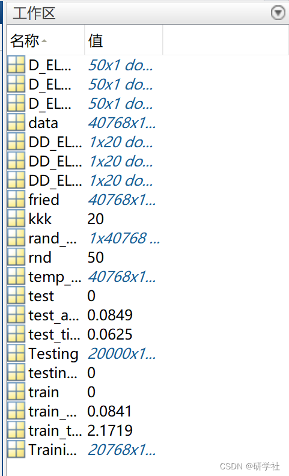

# [Improving Extrem Learning Machine] Bidirectional Extreme Learning Machine (B-ELM) (Matlab Code Implementation)

🏆 Bloggers' Advantage: 🌞🌞🌞 The content of the blog is as thorough and logical as possible to facilitate readers.
⛳️ Mantra: A journey of a thousand miles begins with a single step. 💥1 Overview📚2 Training results🎉3 References🌈4 MATLAB code implementation  
Edited by  
It is clear that the learning efficiency and speed of neural networks are often far below expectations, which has always been a major bottleneck in many applications. Recently, Huang proposed a simple and efficient learning method called the Extreme Learning Machine (ELM), which indicates that compared to some conventional methods, the training time of neural networks can be reduced by a factor of a thousand. However, an open question in ELM research is whether it is possible to further reduce the number of hidden nodes without affecting the learning effect. This brief report proposes a new learning algorithm, called Bidirectional Extreme Learning Machine (B-ELM), where some hidden nodes are not randomly selected. Theoretically, this algorithm tends to reduce the network output error to zero at an early stage of learning. In addition, we found a relationship between the network output error and the network output weights in the proposed B-ELM. Simulation results show that the proposed method is several times faster than other incremental ELM algorithms.  
📚2 Training Results​ Edited by  
Part of the code:  
load fried.mat;  
data=fried';  
data=mapminmax(data);  
data(11,:)=(data(11,:)/2)+0.5;  
data=[data(11,:); data(1:10,:)]';  
rand_sequence=randperm(size(data,1));  
temp_data=data;  
data=temp_data(rand_sequence, :);  
Training=data(1:20768,:);  
Testing=data(20769:40768,:);
[train_time, test_time, train_accuracy11, test_accuracy11]=B_ELM(Training,Testing,0,1,'sig',kkk);  
D_ELM_test(rnd,1)=test_accuracy11;  
D_ELM_train(rnd,1)=train_accuracy11;  
D_ELM_train_time(rnd,1)=train_time;  
end  
DD_ELM_learn_time(kkk)=mean(D_ELM_train_time);  
DD_ELM_train_accuracy(kkk)=mean(D_ELM_train);  
DD_ELM_test_accuracy(kkk)=mean(D_ELM_test);  
end  
%%%%%%%%%%% Load training dataset  
train_data=TrainingData_File;  
T=train_data(:,1)';  
aaa=T;  
P=train_data(:,2:size(train_data,2))';  
clear train_data;                 % Release raw training data array  
%%%%%%%%%%% Load testing dataset  
test_data=TestingData_File;  
TV.T=test_data(:,1)';  
TV.P=test_data(:,2:size(test_data,2))';  
clear test_data;                  % Release raw testing data array  
NumberofTrainingData=size(P,2);  
NumberofTestingData=size(TV.P,2);  
NumberofInputNeurons=size(P,1);  
%%%%%%%%%%% Random generate input weights InputWeight (w_i) and biases BiasofHiddenNeurons (b_i) of hidden neurons  
InputWeight=rand(NumberofHiddenNeurons,NumberofInputNeurons)*2-1;  
BiasofHiddenNeurons=rand(NumberofHiddenNeurons,1);  
tempH=InputWeight*P;  
% Release input of training data  
ind=ones(1,NumberofTrainingData);  
BiasMatrix=BiasofHiddenNeurons(:,ind);       % Extend the bias matrix BiasofHiddenNeurons to match the demention of H  
tempH=tempH+BiasMatrix;  
D_YYM=[];  
D_Input=[];  
D_beta=[];  
D_beta1=[];  
TY=[];  
FY=[];  
BiasofHiddenNeurons1=[];  
%%%%%%%%%%% Random generate input weights InputWeight (w_i) and biases BiasofHiddenNeurons (b_i) of hidden neurons  
start_time_train=cputime;  
for i=1:kkk  
%%%%%%%%%% B-ELM when number of hidden nodes L=2n-1 %%%%%%%  
InputWeight=rand(NumberofHiddenNeurons,NumberofInputNeurons)*2-1;  
BiasofHiddenNeurons=rand(NumberofHiddenNeurons,1);  
BiasofHiddenNeurons1=[BiasofHiddenNeurons1;BiasofHiddenNeurons];  
tempH=P'*InputWeight';  
YYM=pinv(P')*tempH;  
YJX=P'*YYM;  
tempH=tempH';                    % Release input of training data  
ind=ones(1,NumberofTrainingData);  
BiasMatrix=BiasofHiddenNeurons(:,ind);       % Extend the bias matrix BiasofHiddenNeurons to match the demention of H  
tempH=tempH+BiasMatrix;  
%%%%%%%%%%% Calculate hidden neuron output matrix H  
switch lower(ActivationFunction)  
case {'sig','sigmoid'}  
%%%%%%%% Sigmoid  
H = 1 ./ (1 + exp(-tempH));  
case {'sin','sine'}  
%%%%%%%% Sine  
H = sin(tempH);  
%%%%%%%% More activation functions can be added here  
end  
% Release the temparary array for calculation of hidden neuron output matrix H  
%%%%%%%%%%% Calculate output weights OutputWeight (beta_i)  
OutputWeight=pinv(H') * T';            % slower implementation  
% OutputWeight=inv(H * H') * H * T';            % faster  
% implementation  
Y=(H' * OutputWeight)';  
%%%%%%%%%% B-ELM when number of hidden nodes L=2n %%%%%%%  
if i==1  
FY=Y;  
else  
FY=FY+Y;  
end  
E1=T-Y;  
E1_2n_1(i)=norm(E1,2);  
TrainingAccuracy2=sqrt(mse(E1));  
Y2=E1'*pinv(OutputWeight);  
Y2=Y2';  
switch lower(ActivationFunction)  
case {'sig','sigmoid'}  
%%%%%%%% Sigmoid  
[Y22,PS(i)]=mapminmax(Y2,0.1,0.9);  
case {'sin','sine'}  
%%%%%%%% Sine  
[Y22,PS(i)]=mapminmax(Y2,0,1);  
end  
Y222=Y2;  
Y2=Y22';  
T1=(Y2* OutputWeight)';  
switch lower(ActivationFunction)  
case {'sig','sigmoid'}  
%%%%%%%% Sigmoid  
Y3=1./Y2;  
Y3=Y3-1;  
Y3=log(Y3);  
Y3=-Y3';  
case {'sin','sine'}  
%%%%%%%% Sine  
Y3=asin(Y2)';  
end  
T2=(Y3'* OutputWeight)';  
Y4=Y3;  
YYM=pinv(P')*Y4';  
YJX=P'*YYM;  
BB1=size(Y4);  
BB(i)=sum(YJX-Y4')/BB1(2);  
GXZ1=P'*YYM-BB(i);  
cc=pinv(P')*(GXZ1-Y4');  
Y5=P'*cc-(GXZ1-Y4');  
GXZ11=P'*(YYM-cc)-BB(i);  
BBB(i)=mean(GXZ11-Y4');  
GXZ111=P'*(YYM-cc)-BB(i)-BBB(i);  
BBBB(i)=BB(i)+BBB(i);  
switch lower(ActivationFunction)  
case {'sig','sigmoid'}  
%%%%%%%% Sigmoid  
GXZ2=1./(1+exp(-GXZ111'));  
case {'sin','sine'}  
%%%%%%%% Sine  
GXZ2=sin(GXZ111');  
end  
FYY = mapminmax('reverse',GXZ2,PS(i));  
%FYY=GXZ2;  
OutputWeight1=pinv(FYY') * E1';  
FT1=FYY'*OutputWeight1;  
FY=FY+FT1';  
TrainingAccuracy=sqrt(mse(FT1'-E1));  
D_Input=[D_Input;InputWeight];  
D_beta=[D_beta;OutputWeight];  
D_beta1=[D_beta1;OutputWeight1];  
D_YYM=[D_YYM;(YYM-cc)'];  
T=FT1'-E1;  
E1_2n(i)=norm(T,2);  
end  
end_time_train=cputime;  
TrainingTime=end_time_train-start_time_train;  
start_time_test=cputime;  
%%%%%%%%%%%%%%%%%%%%%%%%%%%%test%%%%%%%%%%%%%%%%%%%%%  
tempH_test=D_Input*TV.P;  
clear TV.P;      % Release input of testing data  
ind=ones(1,NumberofTestingData);  
BiasMatrix=BiasofHiddenNeurons1(:,ind);  
tempH_test=tempH_test + BiasMatrix;  
🎉3 References
🌈4 Matlab code implementation

## Images

<!-- PAYMENT_BLOCK -->

## Get this dataset

- Payment link (Stripe): [Buy now](https://buy.stripe.com/3cs8yP7sY87d0vu9AB)
- Payment QR code: 

<!-- /PAYMENT_BLOCK -->
